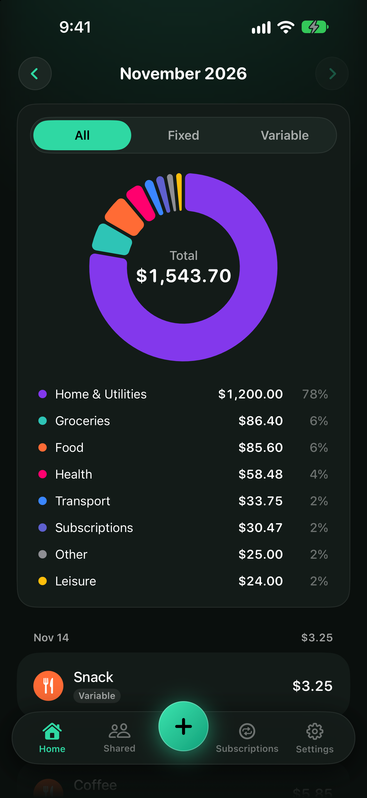
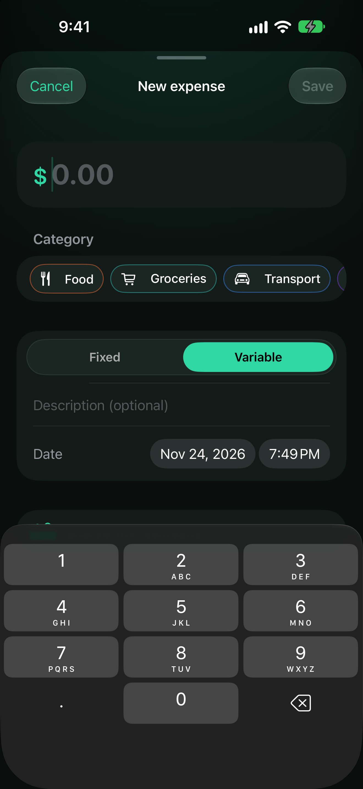
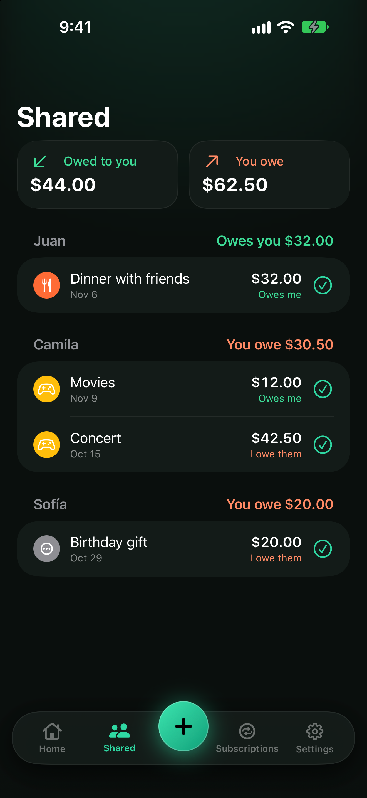
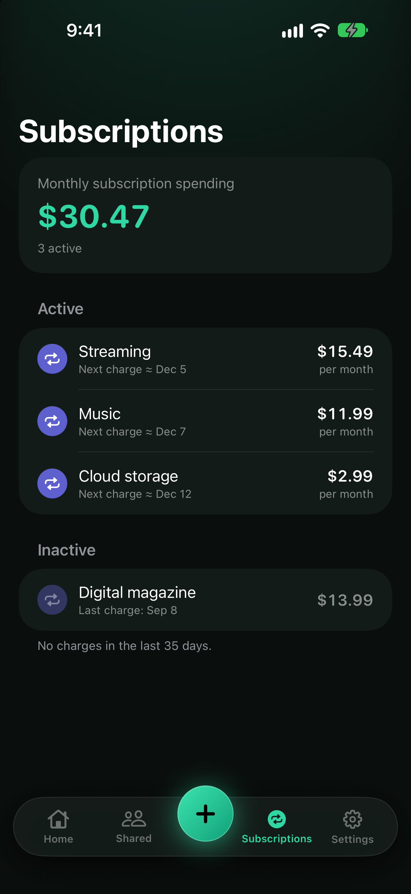

<div align="center">

# MyBasics

**Your everyday spending, in seconds.**

An iPhone app that tracks your expenses by category, shows where your money goes each month,
keeps track of what others owe you (and what you owe them), and keeps an eye on your subscriptions.


<br>

&nbsp;&nbsp;
&nbsp;&nbsp;
&nbsp;&nbsp;


</div>

## Features

- **Monthly overview** with a chart by category, filterable by fixed and variable expenses.
- **Add an expense in seconds**: amount, category, done. The description is optional.
- **Shared expenses**: track who owes you and who you owe, and mark them as settled.
- **Subscriptions**: how much you pay per month, the estimated next charge, and which ones you stopped paying.
- **Custom categories** with their own icon and color.
- **CSV export** of your expenses.
- **Email account**, synced to the cloud. You can delete it from within the app.
- Spanish and English, dark mode.

## How it's built

| | |
| --- | --- |
| **UI** | SwiftUI, MVVM architecture |
| **Backend** | [Supabase](https://supabase.com) (Auth + Postgres with Row Level Security) |
| **Offline** | Local cache of the current month, optimistic saves |
| **Tests** | XCTest (expenses, shared balances, subscriptions, CSV, auth) |

```
MyBasics/
├── App/          # App entry point and dependency container
├── Models/       # Expense, Category, Debt...
├── ViewModels/   # Screen logic and analytics
├── Views/        # SwiftUI screens and components
├── Services/     # Supabase and mock repositories
└── Utilities/
supabase/schema.sql   # Tables, RLS policies and functions
```

## Running it locally

1. Open `MyBasics.xcodeproj` in Xcode and press Run.
   **With no configuration, the app starts with sample data**, so you can try it right away.
2. To use your own backend, copy `Config/Secrets.example.xcconfig` to `Config/Secrets.xcconfig`
   (it is in `.gitignore`) and fill in your Supabase project URL and *publishable/anon key*.
   Then run `supabase/schema.sql` in the SQL Editor. Step by step in [`docs/SUPABASE_SETUP.md`](docs/SUPABASE_SETUP.md) (Spanish).

> **Note:** Never put the *secret* / *service_role* key in the app: it bypasses the database security rules.

## More documentation (Spanish)

- [Supabase setup](docs/SUPABASE_SETUP.md)
- [Sign-in setup](docs/AUTH_SETUP.md)
- [Install on your iPhone for free](docs/INSTALAR_EN_IPHONE.md)
- [App Store checklist](docs/APP_STORE_CHECKLIST.md)
- [Privacy policy](docs/PRIVACY_POLICY.md)
