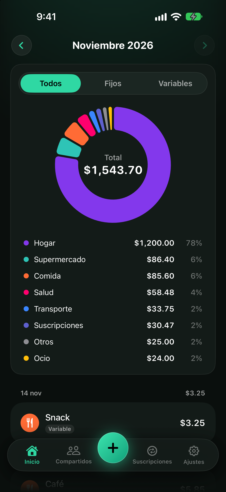
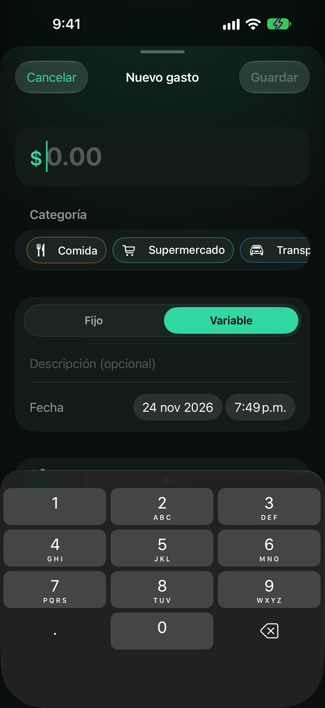
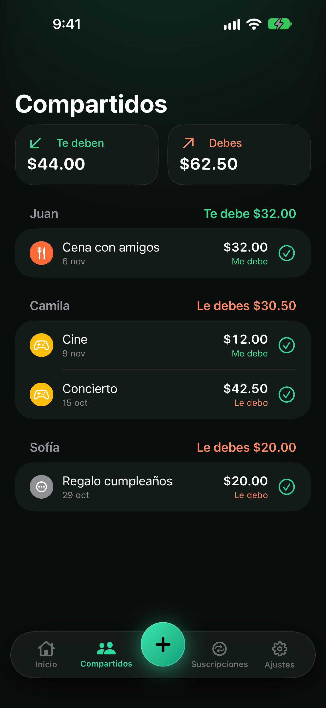
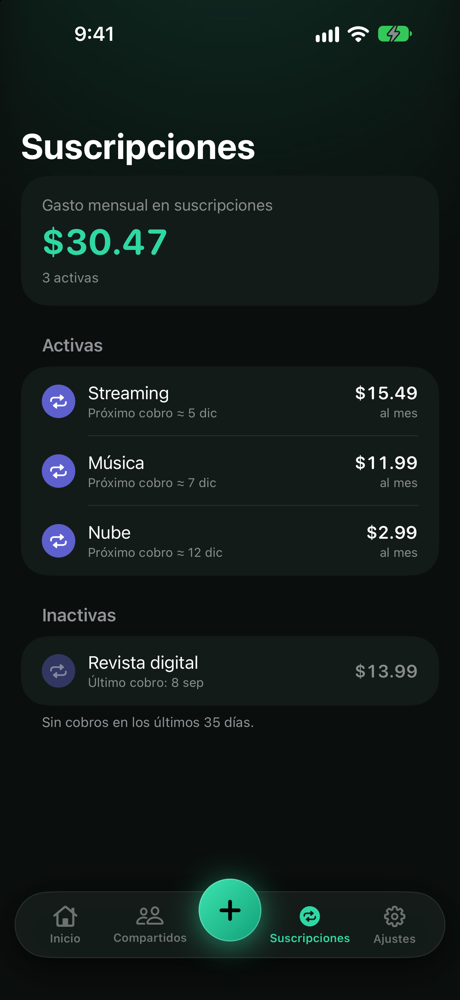

<div align="center">

# MyBasics

**Tus gastos del día a día, en segundos.**

App para iPhone que registra tus gastos por categoría, te muestra en qué se va tu plata cada mes,
lleva la cuenta de lo que te deben (y lo que debes) y vigila tus suscripciones.


<br>

&nbsp;&nbsp;
&nbsp;&nbsp;
&nbsp;&nbsp;


</div>

## Qué hace

- 🍩 **Resumen del mes** con un gráfico por categoría, filtrable entre gastos fijos y variables.
- ⚡ **Agregar un gasto en segundos**: monto, categoría y listo. La descripción es opcional.
- 🤝 **Gastos compartidos**: anota quién te debe y a quién le debes, y márcalo como pagado.
- 🔁 **Suscripciones**: cuánto pagas al mes, el próximo cobro estimado y cuáles dejaste de pagar.
- 🗂️ **Categorías propias** con ícono y color.
- 📤 **Exportar a CSV** tus gastos.
- 🔐 **Cuenta con email**, sincronizada en la nube. Puedes eliminarla desde la app.
- 🌎 Español e inglés · modo oscuro.

## Cómo está hecha

| | |
| --- | --- |
| **UI** | SwiftUI, arquitectura MVVM |
| **Backend** | [Supabase](https://supabase.com) (Auth + Postgres con Row Level Security) |
| **Datos sin conexión** | Caché local del mes en curso, guardado optimista |
| **Tests** | XCTest (lógica de gastos, compartidos, suscripciones, CSV, auth) |

```
MyBasics/
├── App/          # Entrada de la app y contenedor de dependencias
├── Models/       # Expense, Category, Debt…
├── ViewModels/   # Lógica de cada pantalla y analítica
├── Views/        # Pantallas y componentes SwiftUI
├── Services/     # Repositorios Supabase y Mock
└── Utilities/
supabase/schema.sql   # Tablas, políticas RLS y funciones
```

## Correrla en local

1. Abre `MyBasics.xcodeproj` en Xcode y dale ▶︎.
   **Sin configurar nada, la app arranca con datos de ejemplo**, así que puedes probarla de inmediato.
2. Para usar tu propio backend, copia `Config/Secrets.example.xcconfig` como `Config/Secrets.xcconfig`
   (está en `.gitignore`) y completa la URL y la *publishable/anon key* de tu proyecto de Supabase.
   Luego ejecuta `supabase/schema.sql` en el SQL Editor. Paso a paso en [`docs/SUPABASE_SETUP.md`](docs/SUPABASE_SETUP.md).

> ⚠️ Nunca pongas la *secret* / *service_role* key en la app: saltan las reglas de seguridad de la base de datos.

## Más documentación

- [Configurar Supabase](docs/SUPABASE_SETUP.md)
- [Configurar el inicio de sesión](docs/AUTH_SETUP.md)
- [Instalar en tu iPhone gratis](docs/INSTALAR_EN_IPHONE.md)
- [Checklist para el App Store](docs/APP_STORE_CHECKLIST.md)
- [Política de privacidad](docs/PRIVACY_POLICY.md)
